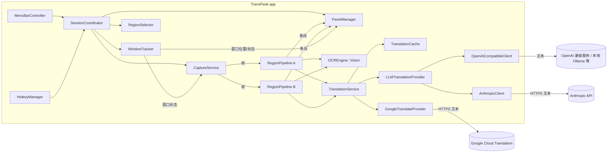
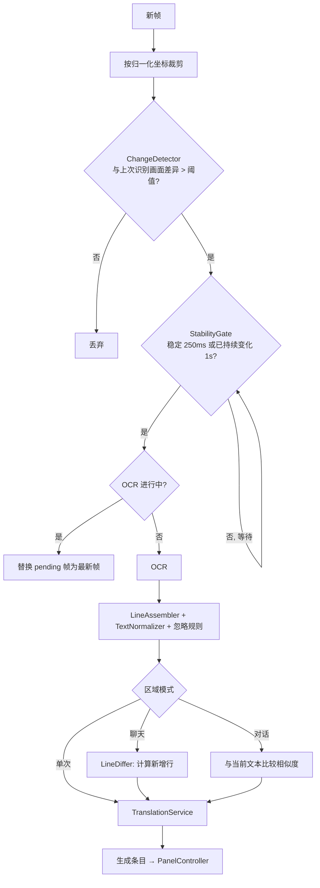

# TransPeek MVP 设计文档

## 概述

TransPeek 是一个原生 macOS 菜单栏应用，使用 Swift 编写。核心链路：

```
目标窗口 → ScreenCaptureKit 截取 → 区域裁剪 → 变化检测 → Vision OCR → 行组装/归一化
        → 增量去重 → 翻译缓存 → Google 翻译或 LLM → 面板（贴边/悬浮）
```

本文档中的需求编号（如 R5.4）对应 `requirements.md`。

### 关键技术决策

| 决策 | 选择 | 理由 |
|---|---|---|
| 语言与 UI | Swift 6 + SwiftUI，窗口层使用 AppKit（NSPanel） | 截屏、OCR、窗口层级都是 Apple 原生能力，直接调用最稳 |
| 最低系统 | macOS 14.0 | 需要 `SCScreenshotManager`（单次截图）和较新的 SwiftUI API |
| 截取 | ScreenCaptureKit，按窗口过滤（`desktopIndependentWindow`） | 只截目标窗口本身，被遮挡也能截；自身面板天然不会被截入（R5.1） |
| OCR | Vision `VNRecognizeTextRequest`，accurate 级别 | 实测约 70–85ms/区域，保留英文空格；fast 级别实测不可用 |
| 窗口跟踪 | `CGWindowListCopyWindowInfo` 轮询 | 不需要辅助功能权限（R1.4）；辅助功能方案留到后续阶段 |
| 翻译（默认） | Google Cloud Translation Basic v2 REST，用户自带 API Key | 官方接口稳定；非官方免费接口有失效和合规风险，开源项目不采用 |
| 翻译（LLM） | 自己实现 OpenAI 兼容和 Anthropic 两种协议的 HTTP 客户端，内置常用服务商预设 | 两种协议覆盖绝大多数服务商和本地模型（Ollama、LM Studio）；直接用 `URLSession` 实现，不引入 SDK |
| 全局快捷键 | Carbon `RegisterEventHotKey` | 不需要额外权限，无第三方依赖 |
| 工程管理 | XcodeGen（`project.yml` 生成 `.xcodeproj`）+ 本地 Swift Package | 避免开源协作中 `project.pbxproj` 冲突；核心逻辑可用 `swift test` 独立测试 |
| 第三方依赖 | 无 | 降低维护和审计成本，新增依赖需在 spec 中说明 |

## 架构



### 模块划分

代码分成两层：

- `TransPeekKit`（本地 Swift Package）：不依赖 AppKit UI 的核心逻辑，全部可单元测试。包括模型、变化检测、行组装、增量去重、翻译服务与缓存、面板布局计算、预设存储。
- `TransPeek`（App target）：AppKit/SwiftUI 相关部分，包括菜单栏、快捷键、截取、框选遮罩、面板窗口、设置界面。

```
TransPeek/
├── project.yml                     # XcodeGen 配置
├── App/
│   ├── TransPeekApp.swift          # @main，菜单栏应用入口
│   ├── AppDelegate.swift
│   ├── MenuBar/MenuBarController.swift
│   ├── Hotkeys/HotkeyManager.swift
│   ├── Permissions/PermissionManager.swift, PermissionGuideView.swift
│   ├── Session/SessionCoordinator.swift
│   ├── Windows/WindowTracker.swift, WindowPickerView.swift
│   ├── Capture/CaptureService.swift
│   ├── Selection/RegionSelectorWindow.swift, RegionConfigView.swift
│   ├── Panel/TranslationPanel.swift, PanelController.swift, PanelManager.swift, PanelContentView.swift
│   ├── Settings/SettingsView.swift, TranslationProfilesView.swift, LLMProfileEditor.swift
│   └── Resources/Info.plist, TransPeek.entitlements, Assets.xcassets
├── Packages/TransPeekKit/
│   ├── Package.swift
│   ├── Sources/TransPeekKit/
│   │   ├── Models/                 # Region, PanelConfig, Preset, Entry, Language
│   │   ├── Pipeline/               # ChangeDetector, StabilityGate, RegionPipeline
│   │   ├── OCR/                    # OCREngine 协议, VisionOCREngine, LineAssembler, TextNormalizer
│   │   ├── Diff/                   # LineDiffer, Similarity
│   │   ├── Translation/            # TranslationProvider 协议, TranslationService, TranslationCache, Batcher, GoogleTranslateProvider
│   │   │   └── LLM/                # LLMTranslationProvider, LLMClient 协议, OpenAICompatibleClient, AnthropicClient, PromptBuilder, ResponseParser
│   │   ├── Resources/LLMPresets.json
│   │   ├── Layout/                 # DockLayoutCalculator, SnapDetector
│   │   └── Storage/                # PresetStore, SettingsStore, KeychainStore
│   └── Tests/TransPeekKitTests/    # 单元测试 + Fixtures（含 OCR 样例图）
├── verify/                         # 技术验证脚本
└── README.md
```

`VisionOCREngine` 放在 Kit 中，Vision 不依赖 AppKit，可以在 `swift test` 中用样例图做集成测试。

### 并发模型

- `CaptureService`：每个目标窗口一个 `SCStream`，回调在专用串行队列上。帧转换为 `CGImage` 后分发给该窗口下的各个 `RegionPipeline`。
- `RegionPipeline`：每个区域一个 `actor`，保证区域内的处理串行，区域之间并行。
- OCR：全局限制最多 2 个并发 Vision 请求，避免多区域同时识别时占满 CPU。
- `TranslationService`：`actor`，内部管理缓存、批量合并和重试。
- UI 更新：条目通过 `@MainActor` 的 `PanelController` 写入 SwiftUI 状态。

## 组件与接口

### PermissionManager（R1）

- `CGPreflightScreenCaptureAccess()` 检查屏幕录制权限，`CGRequestScreenCaptureAccess()` 发起请求。
- 跳转系统设置：`x-apple.systempreferences:com.apple.preference.security?Privacy_ScreenCapture`。
- 应用回到前台时（`NSApplication.didBecomeActiveNotification`）重新检查。系统通常要求重启应用后权限才生效，检测到“已授权但截取失败”时提示重启（R1.2）。
- 重启：启动一个 `/bin/sh` 辅助进程，等当前进程退出后再 `open` 应用，保证同时只有一个实例。应用路径作为参数传入，不拼进命令字符串。
- 退出：`applicationShouldTerminate` 在后台写入防抖中的预设，主线程最多同步等待 2 秒后返回 `terminateNow`。不能用 `terminateLater` 加 MainActor 的 Task 回复：`terminate` 在主队列回调里被调用时，Task 永远得不到执行，应用会卡在退出中（已复现）。

### HotkeyManager（R2）

- 封装 Carbon `RegisterEventHotKey` / `InstallEventHandler`，按 `HotkeyAction` 枚举分发到 `SessionCoordinator`。
- 注册失败（返回 `eventHotKeyExistsErr`）时记录冲突，菜单栏菜单显示提示（R2.4）。

### WindowTracker（R3）

```swift
struct TrackedWindow: Sendable {
    let windowID: CGWindowID
    let pid: pid_t
    let bundleID: String
    var frame: CGRect          // 屏幕坐标，原点在主屏左上角（CG 坐标）
    var isOnScreen: Bool
    var title: String
}

protocol WindowTracking: AnyObject {
    func startTracking(_ windowID: CGWindowID)
    func stopTracking(_ windowID: CGWindowID)
    var updates: AsyncStream<WindowEvent> { get }  // .moved(frame) / .visibilityChanged(Bool) / .closed
}
```

- MVP 实现 `PollingWindowTracker`：对被跟踪的窗口以 30Hz 调用 `CGWindowListCopyWindowInfo(.optionIncludingWindow, windowID)`，读取 `kCGWindowBounds`、`kCGWindowIsOnscreen`。只有变化时才发出事件，满足 R3.4 的 300ms 延迟要求。
- 窗口从结果中消失 → `.closed`（R3.6）；`isOnScreen == false` → `.visibilityChanged(false)`，最小化和切换到其他桌面都会触发（R3.5、R12.3）。
- 协议化设计，后续阶段可替换为基于 `AXObserver` 的实现。
- 窗口列表（R3.1）：使用 `SCShareableContent.excludingDesktopWindows(true, onScreenWindowsOnly: true)`，过滤掉自身 Bundle ID、标题为空且尺寸过小的窗口。缩略图用 `SCScreenshotManager` 生成。

### CaptureService（R5.1、R5.2、R5.6）

- `SCContentFilter(desktopIndependentWindow: scWindow)`：只截取该窗口，被遮挡时仍可截取（R3.7）。
- `SCStreamConfiguration`：
  - `width/height` = 窗口点尺寸 × 屏幕 `backingScaleFactor`，保证原始分辨率。
  - `minimumFrameInterval` = 1 / 采样频率（默认 4fps）。
  - `showsCursor = false`，`pixelFormat = kCVPixelFormatType_32BGRA`，`queueDepth = 3`。
- 同一窗口下所有持续监听区域共用一个 stream。窗口尺寸变化时调用 `updateConfiguration`。
- 只处理状态为 `complete` 的帧（`idle` 帧表示画面没有变化）。帧用 `CIContext` 拷贝成独立的 `CGImage` 后立即归还 stream 的缓冲区，通过 `AsyncStream(bufferingNewest: 1)` 交给 `SessionCoordinator`，按顺序分发给各区域流水线；处理不过来时只保留最新一帧。
- 只有“单次”区域时不开 stream，改用 `SCScreenshotManager.captureImage(contentFilter:configuration:)`。
- 窗口不在屏幕上时停止 stream，恢复后重建（R3.5）。
- 帧只在内存中流转，不落盘（R5.6）。

### RegionSelector（R4.1、R4.2、R4.6）

- 一个无边框、透明、`level = .screenSaver` 的 `NSWindow`，覆盖目标窗口所在屏幕，目标窗口范围外加深遮罩。
- 鼠标拖拽绘制矩形，矩形限制在目标窗口范围内；Esc 取消。
- 完成后把矩形换算为相对目标窗口的归一化坐标，弹出 `RegionConfigView`（SwiftUI popover）。

### RegionPipeline（R5.3–R5.5、R6、R7）

每个区域的处理流程：



#### ChangeDetector

- 把裁剪图缩放到宽 128px（保持比例）的灰度图，计算与“上次识别时的缩略图”的平均绝对差（MAD，0–255）。
- MAD > 2.0（默认）视为变化。与“上次识别时”而不是“上一帧”比较，避免缓慢渐变被漏掉。
- 缩放用 `CGContext`（DeviceGray，低质量插值）绘制，MAD 直接遍历约 3000 个像素计算。规模很小，不需要 vImage，单区域开销远小于 1ms，满足 R14.2。

#### StabilityGate

- 检测到变化后进入等待状态。连续 250ms 内相邻帧 MAD < 阈值则判定稳定，放行。
- 从第一次变化起超过 1s 仍未稳定时强制放行一次（R5.4）。

#### OCREngine

```swift
struct OCRFragment: Sendable { let text: String; let confidence: Float; let box: CGRect } // box 归一化，原点左上
protocol OCREngine: Sendable {
    func recognize(_ image: CGImage, languages: [String]?) async throws -> [OCRFragment]
}
```

- `VisionOCREngine`：`recognitionLevel = .accurate`，`usesLanguageCorrection = true`。源语言为“自动”时设置 `automaticallyDetectsLanguage = true`（R6.2）。
- Vision 返回的坐标原点在左下角，在引擎内转换为左上角原点。

#### OCR 预热（R14.5）

实测（macOS 27，Apple 芯片）：每个新编译或新安装的版本，第一次调用 Vision accurate 识别约需 27–30 秒（系统为新的可执行文件加载并缓存识别模型）；之后新进程的第一次调用约 100–230ms，同一进程内约 60–90ms。这就是“首次识别很慢，之后很快”的原因。

- `VisionOCREngine.warmUp(languages:)` 用一张画有文字的 320×48 示例图识别一次。只有空白时识别器可能跳过模型加载，所以要画文字。
- `OCRWarmUp`（actor）按语言组合去重：同一组合只预热一次，并发调用会等待同一次预热。
- 应用启动后在后台预热“自动检测”和默认源语言；创建区域时预热该区域的语言。预热期间面板的空状态显示“正在加载文字识别模型，首次运行约需半分钟…”。

#### 中文不翻译（R8.9）

`TextScript.containsChinese`：包含汉字（CJK 统一表意文字及扩展区、兼容表意文字），且不含平假名、片假名和韩文。目标语言是中文时，`RegionPipeline` 在发起翻译前把这些行直接标记为 `.done(原文)`，不发送给翻译服务，也不进入上下文。

#### LineAssembler 与 TextNormalizer（R6.3–R6.5、R4.8）

1. 丢弃置信度 < 阈值（默认 0.3）的片段。
2. 按片段中心 y 排序。片段与当前行的垂直重叠 ≥ 较矮片段高度的 50% 时归入当前行，否则开新行。
3. 行内按 x 排序，以单个空格连接。
4. 归一化：折叠连续空白，去除首尾的孤立符号（如 `|`、`•`），统一全角/半角空格。
5. 应用区域的忽略正则，移除匹配片段，结果为空的行丢弃。

验证时观察到的现象：一条聊天行会被拆成“名字 / 频道徽章 / 消息”三段，徽章被识别为 `CHO6` 之类的噪声。第 2、3 步解决拆分问题，徽章噪声由用户配置忽略规则处理（例如 `\bCH[O0]\w{1,2}\b`）。

#### LineDiffer（R7.1–R7.4）

输入上一次的行列表 `prev` 和本次的行列表 `curr`，用于聊天模式：

1. 相似度 `sim(a, b) = 1 - levenshtein(a, b) / max(len(a), len(b))`，`sim ≥ 0.85` 视为同一行（R7.2）。
2. 用最长公共子序列（LCS，按第 1 步的模糊相等）对齐 `prev` 和 `curr`，得到按顺序匹配的行号对。
3. 匹配行的字符数合计 ≥ 8：新增行为 `curr` 中最后一个匹配行之后的部分。
   - 聊天向上滚动：`prev` 的末尾匹配 `curr` 的开头，之后的行是新消息。
   - 向上翻看历史：`curr` 的末尾也能匹配，没有新增行（R7.3）。
   - 中间多识别或少识别了几行：不影响对齐，中间未匹配的行不当作新消息。
4. 没有可靠的匹配（没有匹配，或只靠很短的行匹配）且 `prev`、`curr` 都不为空：输出“可能有遗漏”标记 + `curr` 全部行（R7.4）。
5. 多种对齐长度相同时，优先让 `curr` 中靠前的行参与匹配，遇到重复内容时宁可多显示一条，也不漏掉新消息。
6. 本次结果成为下一次的 `prev`。本次识别结果为空时（例如聊天框短暂隐藏）保留原来的 `prev`，避免聊天框恢复后整屏被当成新消息。

聊天模式在对齐前先丢弃外接矩形贴着区域上下边缘（2 像素以内）的行：滚动时边缘的行只露出半截，识别结果残缺，下一次完整出现时会被当成新消息。

为了不误伤真实的重复消息（例如连续两条 `gg`），去重只基于相邻两次识别结果的对齐，不在整段历史中做全局去重。

第一版用“`prev` 的后缀逐行对齐 `curr` 的前缀”判断重叠。实测 Discord 聊天时，回复引用行有时能识别出来、有时识别不出来，中间多一行就会导致整段对不上，被判为“可能有遗漏”并重复追加整屏内容（测试 `DiscordReplayTests` 用实测数据回放）。所以改为 LCS 对齐。

对话模式（R7.5）：把整块文本合并后与当前显示文本比较，`sim ≥ 0.85` 时不更新。

#### 漏消息分析

只要两次识别之间新增的行数小于区域内可见行数，第 2 步就能找到匹配，不会漏消息。以 4 行可见区域、单次处理约 100ms（OCR）+ 250ms（稳定等待）计算，聊天速度需要超过每秒 10 条才会漏。持续滚动时由 1s 强制放行兜底，此时需要 1s 内刷新超过可见行数才会漏，触发时会显示“可能有遗漏”标记。可以引导用户把聊天区域框大一些，以获得更多余量。

### TranslationService（R8、R16）

```swift
struct TranslationRequest: Sendable {
    let texts: [String]
    let source: Language?            // nil = 自动
    let target: Language
    let context: [ContextPair]       // 最近已翻译条目（原文, 译文），仅 LLM 使用（R16.9）
    let appName: String
}

protocol TranslationProvider: Sendable {
    var fingerprint: String { get }  // 影响译文的参数的哈希，用于缓存键（R8.4）
    // 整个请求失败时抛出（会被重试）；单行失败放在对应位置的 .failure 中（LLM 逐行重试仍失败的行）
    func translate(_ request: TranslationRequest) async throws -> [Result<String, TranslationError>]
}

protocol TranslationServicing: Sendable {   // RegionPipeline 依赖的接口，测试时替换
    func translate(_ texts: [String], options: TranslationOptions) async -> [TranslationState]
}
actor TranslationService: TranslationServicing { ... }
```

- 网络层通过 `HTTPTransport` 协议发送请求（默认实现基于 `URLSession`），测试用 mock transport 代替 `URLProtocol` mock，效果相同但更简单、可并行。
- `ProviderRegistry`（actor）实现 `ProviderResolving`：根据翻译配置和钥匙串中的 Key 创建 provider，按配置 ID 缓存；监听翻译配置和设置的变更通知自动失效，修改 Key 后由设置界面调用 `invalidate()`。“测试连接”用同一个工厂方法创建 provider，但不经过缓存。

- `TranslationService` 根据区域指定的翻译配置（未指定时用全局默认，R16.7）取得对应的 provider 实例，provider 按配置 ID 缓存，配置变化时重建。
- 缓存 `TranslationCache`：内存 LRU，容量 5000 条，键为 `(normalizedText, source, target, fingerprint)`（R8.4）。上下文不参与缓存键，同一句话在不同上下文下会复用同一个译文。这是为了让聊天里大量重复的短句（如 `gg`、`thx`）直接命中缓存，代价是极少数依赖上下文的句子不会重新翻译。
- 批量合并 `Batcher`：在合并窗口内收集请求，按 `(翻译配置, source, target)` 分组发出（R8.5）。同一文本的并发请求合并为一个。

| 参数 | Google | LLM |
|---|---|---|
| 合并窗口 | 150ms | 300ms |
| 每批最大条数 | 100 | 20 |
| 单个配置的最大并发请求 | 4 | 2 |
| 请求超时 | 10s | 30s |

- 重试（两类 provider 共用）：超时、HTTP 429、5xx 按 0.5s / 1s / 2s 指数退避重试，最多 3 次；400、401、403 不重试，直接报错，并在设置页显示原因（R8.6）。
- 回退（R16.12）：LLM 配置开启“失败时回退到 Google”时，最终失败的文本转交 Google provider，结果标记 `fallback = true`，面板显示“已回退”。

#### GoogleTranslateProvider（R8）

- `fingerprint = "google-v2"`。
  - `POST https://translation.googleapis.com/language/translate/v2`，API Key 放在请求头 `X-goog-api-key` 中，不放在 URL 里，避免出现在错误信息和日志中。
  - JSON 请求体：`{"q": [...], "target": "zh-CN", "source": "en", "format": "text"}`，源语言为“自动”时不传 `source`。
  - `format: "text"`，避免返回 HTML 转义字符。
  - 响应 `data.translations[i].translatedText` 与 `q` 顺序一一对应。
- 未配置 Key：直接返回 `.unavailable`，条目只显示原文（R8.3）。
- API Key 由 `KeychainStore` 读写（service: `com.transpeek.app`，account: `google-api-key`），不进入 UserDefaults 和日志（R8.2、R15.3）。

#### LLMTranslationProvider（R16）

结构分两层：`LLMTranslationProvider` 负责提示词组装和结果解析，与协议无关；底层的 `LLMClient` 负责具体接口协议（R16.2）。

```swift
protocol LLMClient: Sendable {
    func complete(system: String, user: String, config: LLMConfig) async throws -> String
}
// OpenAICompatibleClient: POST {baseURL}/chat/completions，Header: Authorization: Bearer <key>
// AnthropicClient:        POST {baseURL}/v1/messages，Header: x-api-key, anthropic-version: 2023-06-01
```

服务商预设（R16.1）打包为资源文件 `LLMPresets.json`，内容如下。Base URL 和模型文档链接在实现时逐一对照各服务商官方文档核对。模型 ID 由用户手动输入（R16.4），预设中不包含任何模型名称，避免模型更新后预设过时。

| 预设 | 协议 | 默认 Base URL | 需要 Key |
|---|---|---|---|
| OpenAI | OpenAI 兼容 | `https://api.openai.com/v1` | 是 |
| Anthropic | Anthropic | `https://api.anthropic.com` | 是 |
| Google Gemini | OpenAI 兼容 | `https://generativelanguage.googleapis.com/v1beta/openai` | 是 |
| DeepSeek | OpenAI 兼容 | `https://api.deepseek.com` | 是 |
| 阿里云百炼 | OpenAI 兼容 | `https://dashscope.aliyuncs.com/compatible-mode/v1` | 是 |
| Moonshot | OpenAI 兼容 | `https://api.moonshot.cn/v1` | 是 |
| 智谱 | OpenAI 兼容 | `https://open.bigmodel.cn/api/paas/v4` | 是 |
| OpenRouter | OpenAI 兼容 | `https://openrouter.ai/api/v1` | 是 |
| Ollama | OpenAI 兼容 | `http://localhost:11434/v1` | 否 |
| LM Studio | OpenAI 兼容 | `http://localhost:1234/v1` | 否 |
| 自定义 | OpenAI 兼容 | 用户填写 | 可选 |

每个预设条目包含：`id`、显示名、协议、默认 Base URL、是否需要 Key、模型文档链接（`modelsDocURL`，“自定义”为空）、是否支持 JSON 输出模式（`response_format: {"type": "json_object"}`）、可选的提示文字 `note`。

2026-10-24 核对结果：Gemini、DeepSeek、智谱、OpenRouter、Ollama、LM Studio 的 Base URL 与官方文档一致。Moonshot 官方文档现在以国际站 `https://api.moonshot.ai/v1` 为例，中国站 `https://api.moonshot.cn/v1` 仍可使用，两个站点的 Key 不通用；预设默认中国站，并在 `note` 中说明国际站地址。JSON 输出模式只对文档明确支持 `json_object` 的预设开启（OpenAI、Gemini、DeepSeek、百炼、Moonshot、智谱、Ollama）。

模型输入框：普通文本框，占位文字为“填写服务商文档中的模型 ID”，旁边是“查看模型列表”链接（用 `NSWorkspace.open` 打开 `modelsDocURL`）。保存时去掉首尾空白，为空则拒绝保存（R16.4）。

Base URL 校验（R16.3）：主机是 `localhost`、`127.0.0.1`、`::1`、`*.local` 或私有网段 IP 时允许 `http`，其余地址必须是 `https`。`Info.plist` 中开启 `NSAllowsLocalNetworking`，允许访问本地 http 服务。

提示词（R16.6、R16.8、R16.9）：

- system：内置模板，用户可整体替换。内置模板的要点：
  - 你是游戏和软件界面的翻译器，把文本从 `{source_lang}` 翻译成 `{target_lang}`，当前应用是 `{app_name}`。
  - 保留人名、物品名中的方括号、数字、价格缩写（如 `180K`）和交易前缀（如 `S>`、`B>`）。
  - 语气简短口语化，符合游戏聊天习惯；不解释，不补充。
  - 只输出 JSON。
- user：

  ```json
  {
    "context": [{"source": "need heal at B", "translation": "B 点需要治疗"}],
    "lines": [{"id": 1, "text": "dragon in 30s"}, {"id": 2, "text": "gg wp"}]
  }
  ```

- 期望输出：`{"translations": [{"id": 1, "text": "..."}, {"id": 2, "text": "..."}]}`。
- 预设支持 JSON 输出模式时，在请求中加上 `response_format`。

结果解析（R16.8）：

1. 去掉可能出现的 Markdown 代码块标记，取第一个完整的 JSON 对象解析。
2. 按 `id` 对应回原文。缺失、多出或无法解析的行收集起来，逐行各请求一次（单行请求只包含一个 `lines` 元素）。
3. 逐行请求仍失败的，标记为失败，进入重试或回退流程。

请求参数：

- `temperature` 取自配置，默认 0.2。
- `max_tokens`：Anthropic 接口必填。按输入字符数 × 4 估算，限制在 256–4096 之间；OpenAI 兼容接口也传同样的值，避免模型输出失控。
- 额外请求参数（R16.10）：保存时用 `JSONSerialization` 校验必须是 JSON 对象。请求时与默认请求体做浅合并，用户参数优先；值为 `null` 时删除该默认参数（例如新模型不接受 `max_tokens` 时可以写 `{"max_tokens": null, "max_completion_tokens": 1024}`）。用于关闭思考模式、设置服务商特有参数（例如 Qwen-MT 的 `translation_options`）。
- 推理型模型延迟高，设置页在模型选择处提示“优先选择非推理的快速模型”。

`fingerprint` = SHA-256（协议 + Base URL + 模型 + 温度 + system 提示词 + 额外请求参数）的前 16 位十六进制字符。

测试连接（R16.11）：用固定示例文本 `"S> Choco Candy Cookie 180K"` 走完整的 provider 流程（不使用缓存），显示译文、耗时或错误信息。模型 ID 填错时，服务商通常返回 400 或 404，错误信息中提示“请检查模型 ID”。

### PanelManager 与 PanelController（R9–R12）

#### 窗口层

`TranslationPanel: NSPanel`：

- `styleMask = [.borderless, .nonactivatingPanel]`，`isMovable = false`。移动和调整大小都由面板自己处理：标题栏拖动用 `NSEvent.mouseLocation` 计算位移（拖动中可以计算吸附候选，松开时切换贴边/悬浮）；悬浮模式四条边和下方两个角可拖动调整大小，贴边模式只有一个调整厚度的边（外侧贴边时在远离窗口的一边，内侧贴边时在朝向窗口中心的一边）。系统自带的窗口缩放无法区分“改厚度”和“改长度”，也无法缩到 6pt 的折叠细边，所以不用。
- 调整大小在 AppKit 层实现（`PanelHostingView`）：`hitTest` 中边缘 6pt、角 14pt 内的点击不交给 SwiftUI；`mouseDown` 后用 `nextEvent` 循环跟踪拖动；`.activeAlways + .mouseMoved` 的跟踪区域设置调整大小光标。可拖动区域由 Kit 中的 `PanelResizeZones` 计算（可测试）。SwiftUI 只画提示（悬浮模式右下角的图标、贴边模式厚度边中间的短横条），不参与命中测试。第一版用 SwiftUI 的 `DragGesture` 和 `onHover` 实现，实测在 TransPeek 不是前台应用时无法使用（R10.1）。
- `level = .floating`，`collectionBehavior = [.canJoinAllSpaces, .fullScreenAuxiliary, .ignoresCycle]`（R12.1）。
- `hidesOnDeactivate = false`，`becomesKeyOnlyIfNeeded = true`，`canBecomeKey = false`，`canBecomeMain = false`，用 `orderFrontRegardless()` 显示，不抢焦点（R11.6）。内容视图 `acceptsFirstMouse` 返回 true，第一次点击就响应。
- 悬停展开折叠面板用 `NSTrackingArea(.activeAlways)` 检测，游戏在前台、TransPeek 不是活跃应用时也能触发（R9.3）。
- 锁定：`ignoresMouseEvents = true`，标题栏降低不透明度（R11.5）。
- 因为设置了 `canJoinAllSpaces`，面板的显示/隐藏完全由 `WindowTracker` 的 `isOnScreen` 控制（R3.5、R12.3）。
- 流水线事件通过 `DispatchQueue.main.async` 投递给 `PanelController`，保证同一区域的“追加”先于“翻译完成”到达。

#### 面板状态

```swift
enum PanelPlacement: Codable {
    case docked(edge: Edge, thickness: CGFloat)          // Edge: top/bottom/left/right
    case floating(offset: CGPoint, size: CGSize)         // 相对目标窗口左上角
}
struct PanelConfig: Codable {
    var placement: PanelPlacement
    var opacity: Double          // 0.2–1.0
    var fontSize: CGFloat
    var showsOriginal: Bool
    var collapsed: Bool          // 仅贴边内侧模式使用
}
```

#### 贴边布局计算 `DockLayoutCalculator`（R9）

输入：目标窗口 frame、贴边方向、厚度、目标窗口所在屏幕的 `visibleFrame`。输出：面板 frame 和 `outside / inside` 模式。

1. 计算外侧候选 frame。例如右边：`x = window.maxX, y = window.minY, w = thickness, h = window.height`。
2. 所选边外侧的可用空间 ≥ 设定厚度 → 外侧模式（R9.2）。
3. 可用空间不足设定厚度但 ≥ 200pt → 缩小厚度到可用空间，仍放外侧。设定的厚度不变，空间变大后自动恢复。
4. 所选边放不下 → 对边按第 2、3 步再试一次（例如窗口贴着屏幕右边缘时放到左侧）。结果中返回实际贴合的边 `edge`。
5. 都不行 → 所选边内侧：`x = window.maxX - thickness`，半透明背景（R9.3、R12.2）。
6. 外侧面板的长度超出屏幕可用区域时裁掉超出部分（例如窗口一部分在屏幕外）。

实测场景：1920×1200 屏幕上的 Chrome 窗口宽 1707pt，右侧只剩 213pt，旧规则（设定厚度 320pt 放不下就进内侧）会把面板放进窗口内，遮住网页内容；新规则放在外侧，宽 213pt。
4. 内侧模式下 `collapsed == true` 时，厚度缩为 6pt，鼠标进入时展开（通过 `NSTrackingArea`），离开 1s 后折叠。

这是纯函数，放在 Kit 中做单元测试。CG 坐标（左上原点）与 Cocoa 坐标（左下原点）的转换集中在 App 层的 `ScreenGeometry` 工具中处理。

#### 悬浮与吸附 `SnapDetector`（R10）

- 拖动时计算面板各边到目标窗口对应边的距离，距离 < 20pt 时返回候选的贴边方向，App 层显示半透明的吸附预览框（R10.3）。
- 松开时有候选方向 → 切换为 `.docked`；贴边面板被拖离边缘超过 20pt → 切换为 `.floating`（R10.4）。
- 悬浮面板的位置保存为相对目标窗口左上角的偏移，窗口移动时面板跟随（R10.2）。
- 高度 < 80pt 时 SwiftUI 视图切换为精简布局（R10.6）。

#### 面板内容 `PanelContentView`（R11）

> 2026-10-24 起，R11.7“每个区域一个面板”由 `../panel-groups/` 替代：`PanelController` 拆分为 `PanelWindowController`（面板窗口）和 `SectionController`（每个区域的一栏），`PanelContentView` 改为 `PanelGroupView`。以下描述的条目渲染规则在每一栏中保持不变。

- `ScrollViewReader` + `LazyVStack` 渲染条目。
- 跟踪“是否在底部”。在底部时新条目自动滚动；不在底部时累计未读数，显示“↓ N 条新消息”（R11.2、R11.3）。
- 条目视图：译文（`fontSize`）+ 原文（`fontSize × 0.8`，次要颜色，受 `showsOriginal` 控制）+ 失败标记和重试按钮。
- “可能有遗漏”标记渲染为一条带文字的分隔线。
- 右键菜单：复制译文、复制原文、复制全部、清空历史（R11.4）。
- 对话模式的面板顶部固定显示当前文本，下方是历史快照。
- 条目历史由 Kit 中的 `PanelHistory`（值类型）维护：应用 `PipelineEvent`（`append` / `replaceAll` / `dialog` / `update`）、历史上限裁剪、清空、复制全部文本，可单元测试。`PanelController` 持有它并驱动 SwiftUI。

### 普通窗口

设置窗口的布局见 `../settings-redesign/`。设置、区域管理、窗口选择、权限引导、框选后的区域配置都由 `WindowPresenter` 用 `NSWindow + NSHostingController` 打开（同一个窗口只打开一个），不使用 SwiftUI 的 `Settings` 场景：菜单栏应用（`LSUIElement`）从 `NSStatusItem` 菜单打开 `Settings` 场景的方式在各系统版本上不稳定。区域配置窗口使用浮动层级并加入所有桌面，在全屏游戏上方也能看到；配置完成后把焦点还给目标应用。窗口尺寸：可调整大小的窗口（窗口选择、区域管理）使用打开时给定的尺寸，SwiftUI 视图只提供最小尺寸（`sizingOptions = .minSize`）；固定大小的窗口（区域配置、权限引导）跟随视图的理想尺寸。含 ScrollView 的视图理想高度是全部内容的高度，跟随它会让窗口超出屏幕。

### SessionCoordinator

- 持有目标窗口与区域、面板的映射关系，处理快捷键和菜单命令。
- 选定窗口 → 加载预设 → 为每个区域创建 `RegionPipeline` 和 `SectionController`，为每个面板创建 `PanelWindowController`（见 `../panel-groups/design.md`）→ 启动截取。
- 区域或面板配置变化时调用 `PresetStore.save`（防抖 500ms）。

## 数据模型

```swift
enum RegionMode: String, Codable { case once, dialog, chat }

struct Region: Codable, Identifiable {
    let id: UUID
    var name: String
    var rect: CGRect                 // 归一化，相对目标窗口，原点左上，0...1
    var mode: RegionMode
    var sourceLanguage: Language?    // nil = 自动
    var targetLanguage: Language
    var ignorePatterns: [String]     // 正则
    var isPaused: Bool
    var panel: PanelConfig
    var translationProfileID: UUID?  // nil = 使用全局默认（R16.7）
}

enum LLMProtocol: String, Codable { case openAICompatible, anthropic }

struct LLMConfig: Codable {
    var presetID: String             // "openai" / "anthropic" / "deepseek" / "ollama" / "custom" ...
    var protocolKind: LLMProtocol
    var baseURL: URL
    var model: String
    var temperature: Double          // 默认 0.2
    var contextCount: Int            // 默认 5，0–20
    var systemPrompt: String?        // nil = 内置模板
    var extraBody: String?           // JSON 对象字符串
    var fallbackToGoogle: Bool
    // API Key 不在此结构中，按 profile ID 存钥匙串
}

struct TranslationProfile: Codable, Identifiable {
    let id: UUID
    var name: String
    var kind: Kind                   // .google / .llm(LLMConfig)
}

struct AppPreset: Codable {
    let bundleID: String
    var regions: [Region]
    var updatedAt: Date
}

struct Entry: Identifiable {        // 仅内存（R15.2）
    let id: UUID
    let regionID: UUID
    let timestamp: Date
    let original: String
    var translation: TranslationState   // .pending / .done(String) / .failed(Error) / .unavailable
    let kind: Kind                       // .line / .gapMarker / .dialogSnapshot
}
```

### 持久化

| 数据 | 位置 |
|---|---|
| 应用预设 | `~/Library/Application Support/TransPeek/presets/<bundleID>.json` |
| 翻译配置（不含 Key） | `~/Library/Application Support/TransPeek/translation-profiles.json` |
| 通用设置（含默认翻译配置 ID） | `UserDefaults` |
| API Key | 钥匙串：Google 为 `google-api-key`，LLM 为 `llm-<profileID>` |
| 历史条目 | 仅内存 |

预设文件带 `schemaVersion` 字段，方便后续迁移。

## 错误处理

| 场景 | 处理 |
|---|---|
| 未授予屏幕录制权限 | 显示引导窗口，禁用截取功能（R1） |
| `SCStream` 意外停止（如窗口被销毁） | 收到 `stream(_:didStopWithError:)` 后通过 WindowTracker 确认窗口状态：已关闭 → 停止区域；仍存在 → 1s 后重建，最多重试 3 次 |
| OCR 失败 | 记录日志，跳过本帧，不影响下一帧 |
| 翻译失败 | 见 R8.6，条目显示原文和失败标记 |
| 快捷键冲突 | 菜单栏提示（R2.4） |
| 预设文件损坏 | 备份为 `.corrupt` 并使用空预设，菜单栏提示 |

日志使用 `os.Logger`，subsystem 为 `com.transpeek.app`。识别文本默认用 `privacy: .private` 标记，API Key 永不记录（R15.3）。

## 测试策略

### 单元测试（TransPeekKit，`swift test`）

- `LineAssembler`：片段拆分、合并、排序、阈值过滤。用实测场景构造 fixture，例如“名字 + 徽章 + 消息”三段合成一行。
- `TextNormalizer` 与忽略规则。
- `LineDiffer`：向上滚动追加、无变化、向下翻看历史、完全无重叠（遗漏标记）、OCR 抖动下的模糊匹配、真实重复消息。
- `ChangeDetector` / `StabilityGate`：用合成图像和注入的时钟测试阈值、稳定判定和 1s 强制放行。
- `TranslationService`：用 mock provider 测试缓存命中、批量合并、并发请求去重、重试和退避（注入时钟）。
- `GoogleTranslateProvider`：用 `URLProtocol` mock 测试请求格式、响应解析和错误码映射。
- `OpenAICompatibleClient` / `AnthropicClient`：用 `URLProtocol` mock 测试请求头、请求体（含额外参数合并）、响应解析和错误码映射（含模型 ID 错误的 400/404 提示）。
- `PromptBuilder`：变量替换、上下文条数截断、JSON 输出模式开关。
- `ResponseParser`：标准 JSON、带代码块标记、条数不匹配、id 缺失或重复、完全无法解析。
- `LLMTranslationProvider`：解析失败后的逐行重试、回退到 Google、fingerprint 随配置变化。
- Base URL 校验：本机、局域网、公网 http/https 的组合。
- `LLMPresets.json`：能正常解码，每个预设字段完整。
- `DockLayoutCalculator` / `SnapDetector`：四个方向的外侧/内侧判定、多屏、全屏。
- `PresetStore`：读写往返、损坏文件处理。

### 集成测试

- `VisionOCREngine` + `LineAssembler`：数据驱动的 OCR 回归测试，记录耗时作为 R14.1 的参考。

OCR 样例库放在 `Packages/TransPeekKit/Tests/TransPeekKitTests/Fixtures/ocr/`，每个场景一个目录：

```
ocr/
├── maple-system-message/       # 场景名：<游戏或应用>-<场景>
│   ├── image.png
│   └── expected.json
└── maple-trade-chat/
    ├── image.png
    └── expected.json
```

`expected.json` 格式：

```json
{
  "source": "photo",                  // photo（手机拍屏）或 capture（真实窗口截图）
  "language": "en-US",                // 识别语言，省略表示自动
  "mustContain": ["Choco Candy Cookie 180K"],   // 必须出现在某一行中的文本（子串匹配，忽略大小写）
  "sameLine": [["Kristen", "dagger"]], // 可选：每组文本必须出现在同一行，用于检查行组装
  "minSimilarity": 0.85,              // 可选：mustContain 允许的最低相似度，默认 1.0（精确子串）
  "notes": "频道徽章会被识别成 CHO6 之类的噪声"
}
```

- 测试自动遍历 `ocr/` 下所有场景目录，新增场景只需放入图片和 `expected.json`，不用改测试代码。
- 每个场景的失败信息会列出实际识别出的所有行，方便调整断言或发现识别问题。
- 测试结束后输出汇总表（场景、耗时、通过与否），用于跟踪不同场景的识别效果。
- 初始样例为 `pic/` 中的两张手机拍屏照片；后续加入真实窗口截图（`source: capture`），尽量覆盖剧情对话、聊天、菜单、物品说明、不同字体和背景等场景。
- 含他人信息（玩家名字、聊天内容）的真实截图只保存在本地，不提交到公开仓库：`pic/` 和这类场景目录写在 `.gitignore` 中。没有本地样例时（例如 CI 或新检出的仓库），OCR 样例库和流水线集成测试跳过；`Fixtures/ocr/README.md` 保证资源目录存在。

### 手动验收清单

截取、面板窗口、全屏、多桌面这些行为依赖真实的窗口环境，写成手动清单放在 `docs/manual-test.md`：遮挡截取、最小化暂停、原生全屏下的面板、切换桌面时隐藏面板、锁定后鼠标穿透、面板不抢焦点、性能指标（用活动监视器和 Instruments 测量）。

## 构建与分发

- 开发环境：Xcode 16+，XcodeGen（`brew install xcodegen`）。
- 环境问题：当前机器的 Command Line Tools 中有一个遗留的 `usr/include/swift/module.modulemap`，会导致 Swift 编译失败。安装 Xcode 后用 `xcode-select -s /Applications/Xcode.app` 切换到 Xcode 自带的工具链即可避开。
- Entitlements：关闭 App Sandbox（屏幕录制和后续的辅助功能 API 在沙盒内受限），允许网络访问。
- Debug 配置的 Bundle ID 为 `com.transpeek.app.debug`，与打包版本区分：系统按 Bundle ID 打开应用时不会打开临时签名的 Debug 版，两者的屏幕录制权限分开授权。钥匙串和数据目录使用固定的 `com.transpeek.app`，两个版本共用（Debug 版第一次读取钥匙串时，系统会询问是否允许）。
- Hardened Runtime：只在 Release 配置开启（显式传 `--options=runtime`，ad-hoc 签名时 Xcode 不会自动加）。Debug 配置关闭，因为 Hardened Runtime 的库验证要求 Team ID 一致，ad-hoc 签名没有 Team ID，Debug 构建的 `TransPeek.debug.dylib` 会加载失败（已实测）。
- `Info.plist`：`LSUIElement = YES`（不在 Dock 显示），`NSScreenCaptureUsageDescription`，`NSAppTransportSecurity.NSAllowsLocalNetworking = YES`（允许访问本地 LLM 服务）。
- 签名：不做 Developer ID 签名和公证。Xcode 中直接运行（⌘R）使用 ad-hoc 签名（`CODE_SIGN_IDENTITY = "-"`）；打包脚本使用固定的自签名证书 “TransPeek Self-Signed”（R15.7）。
- 打包与分发（R15.5–R15.7），参考 Globtype 项目的做法：
  - `Scripts/create_signing_cert.sh`：用系统自带的 openssl 生成 10 年有效期的代码签名证书 “TransPeek Self-Signed”（只含 codeSigning 用途），导入登录钥匙串，只允许 `/usr/bin/codesign` 使用私钥。已存在同名证书时什么也不做。`.p12` 备份和密码写到 `~/Documents/TransPeek-signing-backup/`（不在仓库内）。不修改任何系统信任设置。
  - `Scripts/bundle.sh`：`xcodegen generate` → `xcodebuild -configuration Release ARCHS=arm64`（DerivedData 放在 `build/DerivedData`），把产物复制到 `build/TransPeek.app`，再用 `codesign --force --deep --options runtime --entitlements ... --sign "TransPeek Self-Signed"` 重新签名并校验。找不到证书时退回 ad-hoc 签名，并提示重新构建后需要重新授权。版本号通过 `TRANSPEEK_VERSION` / `TRANSPEEK_BUILD` 传给 `MARKETING_VERSION` / `CURRENT_PROJECT_VERSION`。
  - `Scripts/release.sh`：要求证书必须存在 → 运行 Kit 的 `swift test` → `bundle.sh` → `ditto` 压缩为 `build/TransPeek-<版本>.zip` 并输出 SHA-256。zip 由维护者手动上传到 GitHub Releases。
  - `bundle.sh` 复制完成后删除并注销 DerivedData 中临时签名的中间产物，只在 Launch Services 中注册 `build/TransPeek.app`。否则系统按 Bundle ID 重新打开应用时（例如授权后系统的“退出并重新打开”）可能打开中间产物，它的签名与授权记录不一致，授权一直不生效（已实测，tccd 日志为 “Failed to match existing code requirement”）。
  - 安装包只提供 arm64。项目配置本身不限制架构，Intel 用户可以从源码构建；以后需要通用包时在 `bundle.sh` 中去掉 `ARCHS=arm64` 即可。
  - 自签名证书不受系统信任，用户首次打开下载的 zip 会被 Gatekeeper 拦截，需要在“系统设置 > 隐私与安全性”中点“仍要打开”，或执行 `xattr -dr com.apple.quarantine /Applications/TransPeek.app`。README 中说明。
- 权限注意：屏幕录制权限绑定在代码签名上。使用同一个自签名证书签名的版本之间，重新构建或升级后权限保持有效；ad-hoc 签名每次构建都会变化，需要在系统设置中移除旧条目后重新授权。README 中说明。
- 开源协议：MIT，仓库根目录提供 `LICENSE`。
- CI：GitHub Actions 在 macOS runner 上运行 `swift test`（Kit）和 `xcodebuild build`。

## 风险与待确认事项

| 风险 | 应对 |
|---|---|
| 部分游戏被完全遮挡后停止渲染，截到的画面不更新 | 在 README 中说明；后续阶段评估检测“画面长时间不变且窗口被遮挡”时给出提示 |
| Vision 对艺术字、像素字体识别差 | OCR 引擎接口已预留，后续阶段接入 RapidOCR |
| 轮询方式跟踪窗口，拖动窗口时面板可能有轻微滞后 | 30Hz 轮询可满足 R3.4；后续换成 AXObserver |
| 游戏窗口缩放时 UI 不一定按比例缩放，归一化坐标可能偏移 | MVP 按比例跟随，提供“重新框选”（R4.6）；后续增加锚点模式 |
| Google API 费用 | 缓存 + 只在变化时识别，减少调用量；README 说明费用和免费额度（以 Google 官方定价页为准） |
| LLM 延迟比机器翻译高，快速刷屏的聊天可能出现译文滞后 | 批量请求 + 缓存；设置页提示优先选非推理的快速模型；区域可以单独选择翻译配置，例如聊天用 Google、剧情对话用 LLM |
| 部分模型不严格按 JSON 格式输出 | 支持 JSON 模式的预设开启 `response_format`；解析时容错，失败的行逐行重试 |
| 服务商的模型 ID 和 Base URL 变化频繁 | 不内置模型名称，用户手动输入并通过“测试连接”验证；预设只包含 Base URL 和文档链接，放在单独的 JSON 文件里，方便社区提 PR 更新 |

已确认：

1. 开源协议：MIT。
2. 不做 Apple 公证。提供源码和用自签名证书 “TransPeek Self-Signed” 签名的 arm64 zip 安装包（2026-10-24 由“仅源码”调整）。
3. 最低支持 macOS 14.0。
4. 翻译缓存不区分上下文，不提供“重新翻译”功能。依赖上下文的短句偶尔翻得不准，可以接受。

## 变更记录

| 日期 | 变更 |
|---|---|
| 2026-10-24 | 初版 |
| 2026-10-24 | 确认 MIT 协议、不做正式发布（源码构建 + ad-hoc 签名）、最低 macOS 14.0；更新“构建与分发”和“风险与待确认事项” |
| 2026-10-24 | 新增 LLM 翻译设计（R16）：两种协议客户端、服务商预设、提示词和 JSON 解析、翻译配置模型与存储、区域单独选择翻译配置、回退到 Google；TranslationProvider 接口改为 TranslationRequest + fingerprint；补充测试、ATS 本地网络配置和风险 |
| 2026-10-24 | 模型改为仅手动输入（R16.4）：删除 `listModels` 和推荐模型，预设增加 `modelsDocURL`；更新测试和风险 |
| 2026-10-24 | 确认翻译缓存不区分上下文，不做“重新翻译”，记入“已确认” |
| 2026-10-24 | OCR 集成测试改为数据驱动的样例库（每个场景一张图 + `expected.json`），便于持续加入真实窗口截图 |
| 2026-10-24 | 实现任务 1 时调整：Hardened Runtime 只在 Release 开启，Debug 关闭（ad-hoc 签名下 Debug dylib 无法通过库验证） |
| 2026-10-24 | 设置页重新设计（见 settings-redesign spec）；Debug 构建改用单独的 Bundle ID |
| 2026-10-24 | 修复聊天模式重复追加：LineDiffer 改为 LCS 对齐；聊天模式丢弃贴着区域上下边缘的半截行 |
| 2026-10-24 | 用户试用反馈修复：贴边外侧空间不足时先缩小厚度、再换对边（R9.2）；调整大小改到 AppKit 层实现并加可见提示（R10.1）；新增 OCR 预热（R14.5，记录冷启动实测数据）；目标语言为中文时含中文的行不翻译（R8.9） |
| 2026-10-24 | 修复授权后重启仍提示未授权：bundle.sh 删除并注销 DerivedData 中的临时签名副本 |
| 2026-10-24 | 修复“重启 TransPeek”开出多个实例、旧实例不退出：改为辅助进程等待旧进程退出后再打开；退出时同步等待预设写入，不再使用 terminateLater |
| 2026-10-24 | 分发方式调整（R15.5–R15.7）：新增自签名证书、一键打包和发布 zip 的脚本，安装包只提供 arm64；更新“构建与分发”和“已确认”第 2 条 |
| 2026-10-24 | 实现任务 9–16 时调整：面板改为无边框窗口，移动、调整大小、贴边厚度由自绘手柄处理；面板不能成为 key 窗口；悬停检测用 `.activeAlways` 跟踪区域；截取帧只处理 complete 帧并通过 bufferingNewest(1) 的 AsyncStream 分发；流水线事件经主队列按序投递；普通窗口统一由 `WindowPresenter` 打开 |
| 2026-10-24 | 实现任务 2–8 时调整：provider 返回逐行结果；网络层改用 `HTTPTransport` 协议便于测试；Google Key 放请求头；额外请求参数支持 `null` 删除参数；LineDiffer 允许长重叠中少量行不一致；聊天识别为空时保留上次结果；ChangeDetector 用 CGContext 缩放；新增 `PanelHistory`、`ProviderRegistry` 说明；样例库增加 `sameLine`；记录预设 Base URL 核对结果 |
| 2026-10-24 | R11.7（每个区域一个面板）由 panel-groups 替代；更新“面板内容”和 SessionCoordinator 的说明 |
| 2026-10-24 | 修复窗口选择弹窗看不到“选择”按钮：可调整大小的普通窗口不再跟随 SwiftUI 的理想尺寸（窗口多时列表的理想高度超出屏幕），改为只采用最小尺寸；更新“普通窗口”说明 |
| 2026-10-24 | 含他人信息的真实截图（`pic/`、`maple-*` 样例）改为只保存在本地、不提交；没有本地样例时相关测试跳过 |
